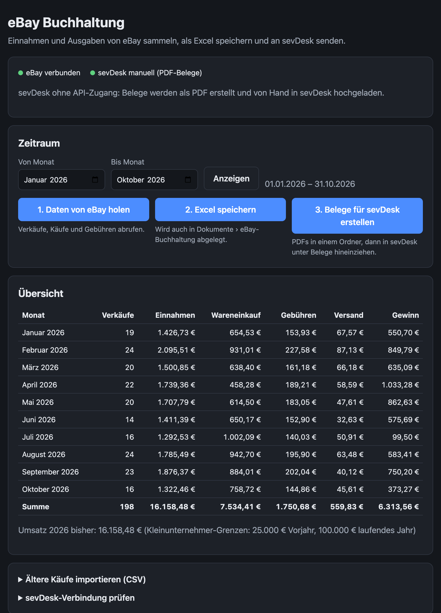

# eBay Buchhaltung

My dad resells items on eBay in Germany and used to do his monthly bookkeeping by hand. Now he opens this app on his Mac, picks a month, and exports an Excel summary of his eBay transactions and PDF receipts for sevDesk.



## Try it

Run these commands from the project folder on a Mac. The demo uses fictional transactions, so you can try both exports without an eBay or sevDesk account.

```bash
./setup.sh
./.venv/bin/python demo.py
```

## Monthly workflow

The app fetches sales, purchases, fees, shipping labels and refunds. It merges transactions by ID so fetching a month twice doesn't duplicate entries. Purchases older than eBay's 90-day API window can be imported from CSV.

Check the workbook against eBay's Seller Hub reports before uploading receipts. My dad's sevDesk plan doesn't include API access, so the app generates PDFs he can upload himself: one receipt per purchase, a monthly sales summary and a monthly fee summary.

## How I built it

Claude Code wrote most of the code. I worked out the receipt format with my dad, set up eBay authentication, and tested the app on his Mac. Our first request for fee data returned `403 Missing x-ebay-signature-key` even with a valid OAuth token. The fix was to [sign the request](ebay_tool/signing.py) with a key registered with eBay.

See [SETUP.md](SETUP.md) to connect a live account. To run the offline tests after setup:

```bash
./.venv/bin/python -m unittest discover -s tests -v
```

This tool is not tax advice. Check the numbers with a tax advisor.
